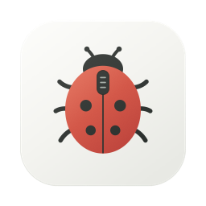
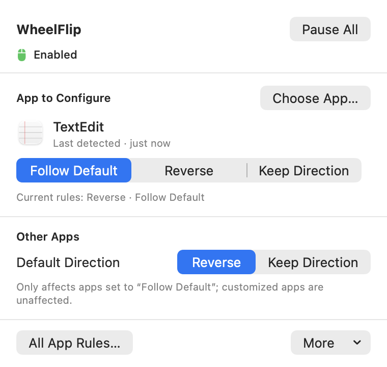
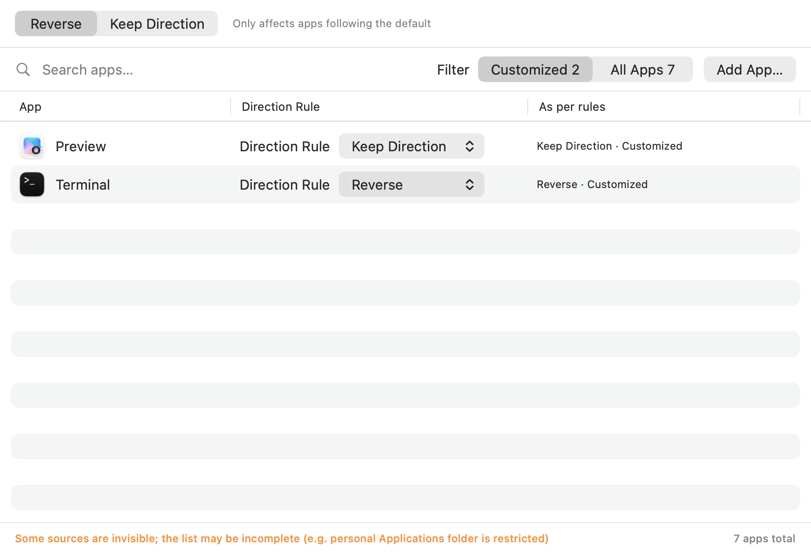

<p align="center">
  
</p>

# WheelFlip

**Reverse your mouse wheel. Keep your trackpad natural. Set a different direction for each app.**

A small, native macOS menu bar utility built with SwiftUI and AppKit. No account, ads, analytics, or network connection required.

[简体中文](README.zh-CN.md) · [Build from source](#build-from-source) · [Contributing](CONTRIBUTING.md) · [MIT license](LICENSE)


[](https://github.com/WoWJony/wheelflip/actions/workflows/ci.yml)

<p align="center">
  
</p>

## What it does

- **Separate mouse and trackpad behavior.** Reverse discrete wheel events while leaving continuous scrolling unchanged.
- **Choose per-app rules.** Each app can reverse, keep its direction, or follow your default.
- **Follow the receiving window.** Rules use the app receiving the scroll event, including an unfocused window under the pointer.
- **Pause everything in one click.** Restore ordinary scrolling without losing your rules.
- **Stay out of the way.** A menu bar panel, no Dock icon, and English / Simplified Chinese UI.
- **Keep settings on your Mac.** Rules and app bookmarks stay in the app's local container. [Privacy details](PRIVACY.md).

For example: keep your browser's wheel direction reversed, preserve the original direction in a drawing app, and keep natural scrolling on the trackpad.

<p align="center">
  
</p>

Screenshots are rendered from the real UI with sample data.

## Build from source

Requires **macOS 14 or later**, Xcode with the macOS 14 SDK or newer, and [XcodeGen](https://github.com/yonaskolb/XcodeGen). There is no notarized binary download at present.

```sh
brew install xcodegen
git clone https://github.com/WoWJony/wheelflip.git
cd wheelflip/app
xcodegen generate
xcodebuild -project WheelFlip.xcodeproj -scheme WheelFlip \
  -configuration Release -derivedDataPath build/local build
codesign -f -s - --entitlements WheelFlip/WheelFlip.entitlements \
  --identifier com.jonywu.WheelFlip \
  build/local/Build/Products/Release/WheelFlip.app
open build/local/Build/Products/Release/WheelFlip.app
```

This uses a local ad-hoc signature. Quit an existing copy before replacing its app bundle; a rebuild can invalidate Accessibility authorization. Use a separate build directory during development.

## First run

1. Keep **Natural scrolling** enabled in macOS if you want natural trackpad scrolling and traditional mouse-wheel scrolling.
2. Open **System Settings → Privacy & Security → Accessibility**.
3. Add the exact `WheelFlip.app` you built, then enable its switch. The panel can reveal that copy in Finder.
4. Use **Reopen and Check** in WheelFlip after granting access.
5. Choose a default direction and add any per-app exceptions.

**Lifecycle:** starting the rule service registers WheelFlip as a login item. Pause keeps the login item; pause lasts only for the current session. **Quit WheelFlip** stops the service and unregisters the login item. Login items can also be managed in System Settings.

## Scope and limitations

- WheelFlip adjusts direction, not pointer acceleration, scroll speed, or smoothing.
- Vertical and horizontal wheel directions are reversed together.
- Continuous events pass through, including typical trackpad and Magic Mouse scrolling. A mouse driver that emits continuous events can also bypass reversal.
- Unidentified scroll targets use the default rule.
- App discovery can be limited by the sandbox. Use **Add App…** for apps in other locations.
- Run one scroll-modifying utility at a time to avoid double reversal.
- If a rebuild loses permission, remove the old Accessibility entry, add the new app, and reopen it.

## Development

```sh
python3 -m unittest discover -s test -p 'test_*.py' -v
cd app
xcodegen generate
xcodebuild test -project WheelFlip.xcodeproj -scheme WheelFlip \
  -destination 'platform=macOS' -derivedDataPath build/validation
```

Unit tests use fakes for the engine and login service. Live event tests need Accessibility permission and careful instance isolation; see [CONTRIBUTING.md](CONTRIBUTING.md).

| Location | Purpose |
| --- | --- |
| `app/WheelFlip/` | Menu bar app, event engine, rules, and permissions |
| `app/Tests/` | XCTest suite |
| `test/` | Installer regression and live scroll tests |
| `probe/` | Optional event-routing diagnostics |
| `Sources/`, `launchd/` | Legacy CLI implementation |

## Contributing

Bug reports, translations, and focused improvements are welcome. Please include your macOS version, mouse model, and reproduction steps. Read the [contribution guide](CONTRIBUTING.md) before attaching diagnostic logs.

If WheelFlip solves a small annoyance for you, a star helps other Mac users find it.

Made by [Jony Wu](https://github.com/WoWJony). Released under the [MIT license](LICENSE).
