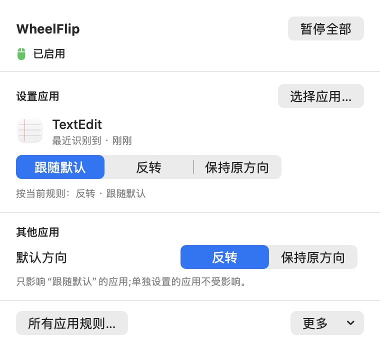

# WheelFlip

**鼠标滚轮反转，触控板保持自然滚动；每个应用可以设置不同方向。**

用 SwiftUI / AppKit 编写的 macOS 菜单栏小工具。无需账号或联网，没有广告和统计服务。

[下载安装](https://github.com/WoWJony/wheelflip/releases/latest) · [让 Agent 帮你安装](#让-agent-帮你安装) · [English](README.md) · [MIT 许可证](LICENSE)

<p align="center">
  
</p>

## 功能

- 只反转离散滚轮事件，连续滚动事件原样通过。
- 每个应用可设为「跟随默认 / 反转 / 保持原方向」。
- 按实际接收滚动事件的窗口所属应用选择规则，包括鼠标下方的非前台窗口。
- 一键暂停全部，保留已保存规则。
- 菜单栏常驻，无 Dock 图标，提供中英文界面。
- 设置保存在本机应用容器中，不上传应用清单或滚动记录。详见[隐私说明](PRIVACY.md)。

截图使用真实界面和演示数据生成。

## 下载安装

**macOS 14+ · 同时支持 Apple 芯片和 Intel · 不用安装 Xcode**

[下载 DMG 安装包](https://github.com/WoWJony/wheelflip/releases/latest/download/WheelFlip-universal.dmg) · [下载 ZIP](https://github.com/WoWJony/wheelflip/releases/latest/download/WheelFlip-universal.zip) · [版本说明与校验文件](https://github.com/WoWJony/wheelflip/releases/latest)

1. 打开 DMG，把 **WheelFlip** 拖到旁边的 **Applications（应用程序）**。ZIP 用户先解压，再把应用移到应用程序文件夹。没有全局安装权限时，可以放进自己的 `~/Applications` 文件夹。
2. 打开安装好的副本，然后推出 DMG。WheelFlip 的图标在**菜单栏**，不会出现在 Dock。
3. 按下方[首次使用](#首次使用)指引开启辅助功能权限。

当前版本使用**临时签名，尚无 Developer ID 签名和 Apple 公证**。首次打开若被提示无法验证，确认信任这个版本后，可在「系统设置 → 隐私与安全性」点击「仍要打开」。详见 [Apple 官方说明](https://support.apple.com/en-us/102445)，系统安全检查保持开启即可。

升级前先退出 WheelFlip，再替换同一安装位置的应用。规则保留在本机容器中；新版本可能需要重新授权。

## 让 Agent 帮你安装

把下面整段复制给 **Claude Code、Codex 或其他能够操作你这台 Mac 终端的 Agent**。它负责下载安装、打开授权页面和定位应用；你只需处理系统确认弹窗并打开权限开关。

```text
请把 https://github.com/WoWJony/wheelflip 安装到我这台 Mac。
先读仓库 README.md 和 AGENTS.md，用我的语言简短说明进度，实际完成安装，
不要只给我一串命令。

1. 确认你能够访问我的 Mac，且系统是 macOS 14 或更新版本。仅有云端工作区
   无法在我的电脑上安装；如果没有本机访问能力，请明确说明。
2. 优先下载官方最新 Release 中的 WheelFlip-universal.zip 和 SHA256SUMS.txt，
   校验 ZIP 的 SHA-256 后再解压。安装包不需要 Xcode 或 GitHub 账号。
   只有我要求或没有可用 Release 时，才按 README 在独立构建目录从源码构建。
3. 安装到 ~/Applications/WheelFlip.app；升级已有安装时，沿用原位置。
   替换前正常退出旧实例，备份旧应用包并保留用户设置。只用 open 启动安装
   完成后的副本，不直接执行包内二进制，也不要从 DMG 里运行。
4. 当前版本未经过 Apple 公证。如 macOS 提示无法验证开发者，请主动执行：
     open 'x-apple.systempreferences:com.apple.preference.security'
   打开「隐私与安全性」，引导我点这个应用对应的「仍要打开」。系统确认、密码
   或 Touch ID 由我在 macOS 弹窗里完成，保持系统安全检查开启。
   不要把「应用已损坏」或恶意软件警告当作普通的开发者验证提示。
5. 把安装好的应用绝对路径存入 wheelflip_app，主动执行：
     open -R "$wheelflip_app"
     open 'x-apple.systempreferences:com.apple.preference.security?Privacy_Accessibility'
   然后一次只引导我完成这一步：点击「+」→ 按 Command-Shift-G → 粘贴你给出
   的完整父文件夹路径 → 选择 WheelFlip.app →「打开」→ 开启旁边的开关。
   请给出已展开的实际路径，不要留占位符。列表已有正确副本时只需开开关。
   等我确认操作完成后再继续。
6. 我确认后，用应用里的「重新打开并检查」，或正常退出后用 open 重新打开
   同一副本。你不能操作界面时，就引导我点这个按钮。核验面板显示「已启用」；
   看不到屏幕时请我确认。不要用 headless 检查冒充应用授权成功，因为它可能
   继承终端权限。仍提示无权限时，帮我仅移除并重新添加 WheelFlip 的旧条目。
7. 请我试一下鼠标滚轮和触控板，然后说明安装版本、路径、尚未完成的步骤，
   以及怎样暂停或退出。「暂停」保留登录自启，「退出」注销登录自启。
   未真正运行并获得权限前，不要宣称安装已全部成功。
```

## 从源码构建

需要 macOS 14+、包含 macOS 14 或更新 SDK 的完整 Xcode，以及 XcodeGen。这些工具仅在从源码构建时需要。

```sh
brew install xcodegen
git clone https://github.com/WoWJony/wheelflip.git
cd wheelflip/app
xcodegen generate
xcodebuild -project WheelFlip.xcodeproj -scheme WheelFlip \
  -configuration Release -derivedDataPath build/local build
codesign -f -s - --entitlements WheelFlip/WheelFlip.entitlements \
  --identifier com.jonywu.WheelFlip \
  build/local/Build/Products/Release/WheelFlip.app
open build/local/Build/Products/Release/WheelFlip.app
```

构建使用本地临时签名。替换应用前先退出旧副本；重新构建可能使辅助功能授权失效。开发时请使用独立构建目录。

## 首次使用

1. 如果希望触控板保持自然滚动、鼠标采用传统方向，请保持系统「自然滚动」开启。
2. 点菜单栏的 WheelFlip 图标，在授权指引中点「打开系统设置…」，直接进入辅助功能页面。
3. 点「在 Finder 中显示此应用」定位安装好的副本；在辅助功能里点「+」添加这一份 `WheelFlip.app` 并开启开关。系统要求验证时，在 macOS 弹窗中完成。
4. 在 WheelFlip 中选择「重新打开并检查」。
5. 设置默认方向，再添加各应用的例外规则。

服务启动后会注册登录自启；「暂停全部」保留登录项，只在本次会话生效。**「退出 WheelFlip」会停止服务并注销登录自启。** 也可以在系统设置中管理登录项。

## 使用边界

- 只处理方向，不提供平滑滚动、速度或指针加速度设置。
- 横向和纵向滚轮一起反转。
- 触控板和 Magic Mouse 通常产生连续事件，不会被反转；某些鼠标驱动产生的连续事件也会原样通过。
- 无法识别应用时采用默认规则；沙盒未能发现的应用可以手动添加。
- 同时运行多个滚动修改工具可能造成双重反转。
- 重建后若权限失效，请移除旧辅助功能条目、添加新副本并重新打开。

欢迎提交问题、翻译和改进；测试步骤见[贡献指南](CONTRIBUTING.md)。如果这个小工具帮到了你，欢迎点个 Star，让更多人找到它。

作者：[Jony Wu](https://github.com/WoWJony)。使用 [MIT 许可证](LICENSE)。
